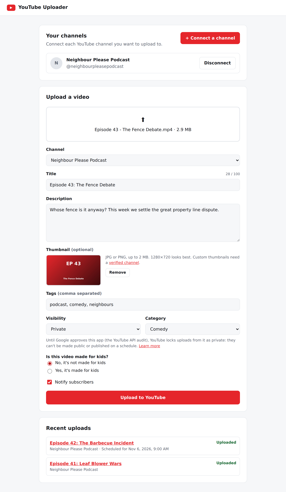

# YouTube Uploader

[](https://github.com/ChristopherSaunders/Youtube_Uploader/actions/workflows/ci.yml)

A clean, simple browser app for uploading videos to your YouTube channels in a couple
of clicks. Connect one or more channels with Google sign-in, fill in the details, and
the app handles the upload: in chunks that survive a dropped connection, with live
progress, thumbnails and scheduled publishing.

Built with Node.js and Express, a vanilla JavaScript front end, and tested end to end
with Playwright on Linux and Windows.

<p align="center">
  
</p>

## Features

- **Multiple channels.** Connect any channel you can sign in to, via Google OAuth 2.0.
  The app never sees a password.
- **Full video details.** Title, description, tags, category, visibility, "made for
  kids", subscriber notifications and a custom thumbnail, checked against YouTube's
  rules before any upload quota is spent.
- **Scheduled publishing.** Pick a date and time in your own time zone.
- **Uploads that survive network problems.** Videos go up in 8 MB chunks using
  YouTube's resumable protocol. After a dropped connection or server error, the app
  asks YouTube how much arrived and continues from there, with exponential backoff.
- **Live two-step progress.** Browser → app, then app → YouTube. You can close the
  page once the second step starts.
- **Expired sign-ins handled gracefully.** The app checks a channel's sign-in before
  sending a large file. If it expires mid-upload, the video is kept so it can be
  retried after reconnecting, without sending it again.
- **Upload history** with links to each video and YouTube Studio.
- **Light and dark mode**, and a layout that works on phones.

## Tech stack

| Area | Choice |
|------|--------|
| Server | Node.js 22+, Express 5 |
| Google APIs | `googleapis` (OAuth 2.0, YouTube Data API v3); resumable upload protocol implemented directly with `fetch` |
| Storage | SQLite via Node's built-in `node:sqlite`; refresh tokens encrypted with AES-256-GCM |
| Uploads | Streamed to disk with `busboy`, so large videos never sit in memory |
| Front end | Plain HTML, CSS and JavaScript, with no build step |
| Testing | Playwright end-to-end tests against a faked Google/YouTube; ESLint |
| CI/CD | GitHub Actions: lint, dependency audit, and tests on Ubuntu and Windows × Node 22 and 24; tagged releases |

## How it works

```
Browser ──(multipart upload, progress)──▶ Express app ──(resumable upload, 8 MB chunks)──▶ YouTube
   ▲                                           │
   └────────── polls /api/uploads/:id ─────────┘   OAuth 2.0 refresh tokens, encrypted in SQLite
```

- **Signing in:** connecting a channel runs Google's OAuth flow with a CSRF `state`
  check. The app also confirms the user granted the upload permission, then stores
  the channel's refresh token encrypted at rest.
- **Uploading:** the browser sends the video to the app, which saves it to a temp
  file and uploads it to YouTube in the background. The page polls for progress.
- **Ready for multiple users:** every channel and upload belongs to a user, and every
  query is scoped to that user. Locally a single owner is signed in automatically.
  The hosted, multi-user version is the next phase in [PLAN.md](PLAN.md).

## Project structure

```
src/
  server.js       starts the HTTP server
  app.js          Express app: sessions, static files, routes, error handling
  auth.js         Google OAuth flow and sign-in checks
  api.js          JSON API used by the browser
  upload.js       receives videos, validates details, runs uploads and retries
  resumable.js    YouTube resumable upload protocol with backoff
  accounts.js     connected channels (encrypted tokens)
  db.js           SQLite schema and migrations
  crypto.js       AES-256-GCM token encryption
  config.js       all environment-based settings
public/           the browser app (HTML, CSS, JS)
tests/e2e/        Playwright tests and the fake Google/YouTube server
.github/          CI, release and Dependabot configuration
start.bat         Windows: double-click to start the app and open the browser
```

## Getting started

Requires [Node.js](https://nodejs.org) 22.13 or newer, and a Google Cloud project with
the YouTube Data API v3 enabled and an OAuth client whose redirect URI is
`http://localhost:3000/auth/callback`. Phase 0 in [PLAN.md](PLAN.md) walks through it.

1. Install dependencies:
   ```sh
   npm install
   ```
2. Create your settings file:
   ```sh
   cp .env.example .env
   ```
3. Open `.env` and paste in your `GOOGLE_CLIENT_ID` and `GOOGLE_CLIENT_SECRET`.
4. Generate the two secrets and paste the printed lines into `.env`:
   ```sh
   npm run keygen
   ```
5. Start the app:
   ```sh
   npm start
   ```
6. Open http://localhost:3000 and click **Connect a channel**.

**Windows shortcut:** after the first setup, double-click `start.bat` to start the
app and open it in your browser. Close its window to stop the app. To put it on
your desktop: right-click `start.bat` → **Show more options** → **Send to** →
**Desktop (create shortcut)**.

Google will warn that the app isn't verified yet. That's expected for your own
project: click **Continue**, and tick both YouTube permission boxes.

`.env` and `data/` (the local database with your encrypted tokens) are ignored by
git. Never commit them.

## Tests

End-to-end tests drive the real app in a browser with [Playwright](https://playwright.dev).
Google sign-in and YouTube are faked (`tests/e2e/fake-google-server.js`), so tests never
touch a real channel or use upload quota.

```sh
npx playwright install chromium   # once
npm test                          # lint + end-to-end tests
npm run test:e2e -- --ui          # watch the tests run, step by step
```

## CI/CD

GitHub Actions (`.github/workflows/`):

- **CI** runs on every push and pull request: lint, a security audit of the app's
  dependencies, and the end-to-end tests on Linux and Windows with Node 22 and 24.
  If tests fail, the Playwright report is attached to the run.
- **Release** runs when you push a version tag. It runs CI, then publishes a GitHub
  Release with a zip of the app. To release:
  1. Update `"version"` in `package.json` (e.g. `0.2.0`) and commit it.
  2. `git tag v0.2.0` then `git push origin v0.2.0`

  Deploying to a server will be added here once the app is hosted (PLAN.md Phase 6).

## Roadmap

[PLAN.md](PLAN.md) has the full plan. Next up:

- Pass Google's YouTube API audit. Until then, YouTube keeps uploads from the app private.
- Host it online with "Sign in with Google", so anyone can upload to their own channels.
